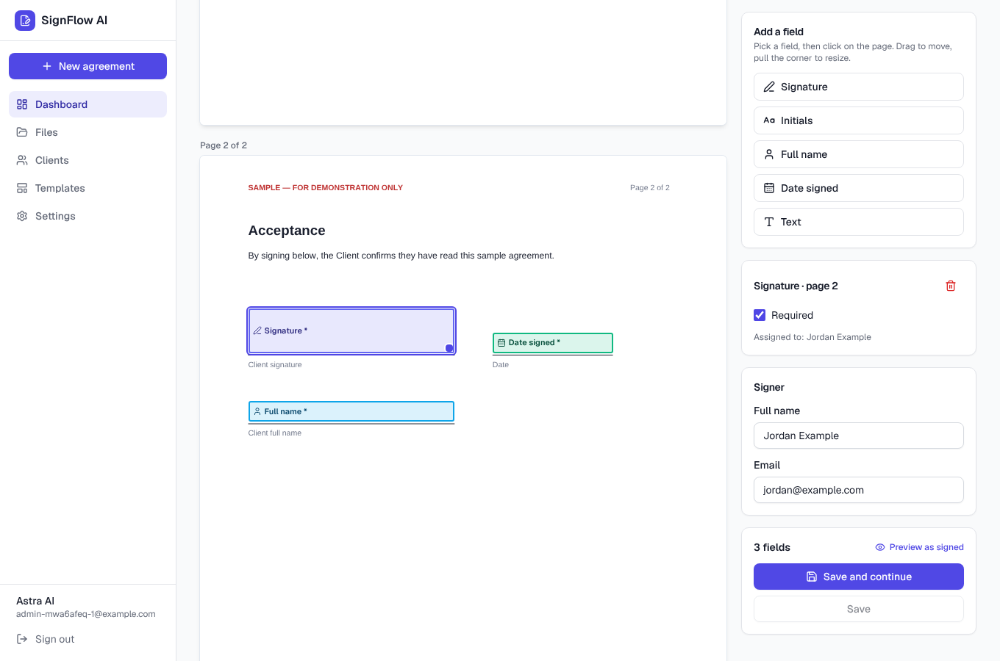

# SignFlow AI

Get the agreement signed on every client file, without the back-and-forth.

SignFlow AI is a multi-company web app for firms whose clients must sign the same agreement before work starts. An administrator uploads any PDF agreement (or picks a saved template), drags signature and text fields onto it, and sends a secure link. The client signs in the browser without creating an account. The server stamps the signature into the original PDF, stores the signed copy privately against the right file, marks the agreement Signed and keeps an audit trail.



---

## 1. The client problem

> "Every client we take on has to sign the same agreement before we can start work. Right now that is manual, and it slows down every file. I want something that automates getting that agreement signed on every file. Once it works for us, I want to sell it to every other company in our industry."

A *file* is one job or case for one client. Astra AI is the first customer, and the product will be tested with an agreement (the MIND client agreement) that was never shared in advance. So the core requirement is that **an unfamiliar PDF can be uploaded, prepared and signed end to end by a non-developer.**

## 2. The solution in one paragraph

Each company gets its own workspace. Inside it there are **clients**, **files** (one job for one client) and **agreements** attached to files. The standard agreement is uploaded once and saved as a **template** with its fields already placed. After that, creating a new file can create the agreement from the template and send the signing link in the same step. Statuses (Draft → Ready → Sent → Viewed → Signed, plus Expired / Cancelled / Failed) update automatically from what actually happened, and the signed PDF is always one click away on the file.

## 3. Features

Legend: ✅ implemented and covered by automated tests · 🟡 implemented, tested by hand only · 🔜 planned, not built

| Area | Feature | State |
|---|---|---|
| Accounts | Email + password sign-up and login (Supabase Auth); each sign-up gets its own workspace | ✅ |
| | `SIGNUPS_DISABLED=true` closes sign-up after reviewers have accounts | 🟡 |
| Records | Clients, files (unique reference per workspace), agreements linked to files | ✅ |
| Upload | Any valid PDF up to **15 MB / 300 pages**: single or multi-page, mixed sizes, portrait/landscape, rotated pages, no existing form fields needed | ✅ |
| | Checked server-side by parsing the file (not the extension); non-PDF, corrupted and encrypted files refused with a clear message; encryption is never bypassed | ✅ |
| | Large files go straight from the browser to private storage via a one-time upload URL, then are validated on the server | ✅ |
| | Original stored unchanged (SHA-256 recorded); the signed copy is always built from it | ✅ |
| Field editor | Every page previewed with PDF.js; add / move / resize / delete fields; required or optional; field types: signature, initials, full name, date signed, text | ✅ |
| | Positions stored as fractions of the displayed page, so they are independent of zoom, screen size, page size, CropBox and page rotation | ✅ |
| Signing | Public link, no account; full document view; click each field to fill it; draw or type a signature (script font); clear and redo; mobile layout | ✅ |
| | Explicit consent checkbox with e-signature wording; required fields and consent checked again on the server | ✅ |
| | Clear pages for invalid, expired, cancelled and already-signed links | ✅ |
| Signed PDF | Generated on the server with pdf-lib: signature images and text drawn at the saved positions on the original pages, unrelated content untouched, plus a signing certificate page appended at the end | ✅ |
| | Non-Latin names print with a bundled Unicode font (DejaVu Sans) | ✅ |
| | Agreement becomes Signed only after the signed PDF is stored; on failure it is marked Failed, stays unsigned, and the signer can retry | ✅ |
| | Idempotent: double clicks and two simultaneous submissions produce exactly one signed document | ✅ |
| Links | 256-bit random tokens; only a SHA-256 hash is stored; server-side expiry (workspace setting, default 14 days); re-issuing a link revokes the old one; a link only ever opens its own agreement | ✅ |
| Email | Resend invitation with title and Sign button; result recorded as *accepted by provider* or *failed*, never as "delivered"; works fully without email via **Copy link** | ✅ |
| Templates | Upload once, place fields once, reuse; each use creates its own document copy and signing record, so no previous client's signature can carry over | ✅ |
| Automation | New file + template → agreement created and link sent in one step; default template setting; automatic statuses; automatic audit events; awaiting-signature list on the dashboard | ✅ |
| Tracking | Dashboard counts, recent activity, recent files, agreement table; per-agreement audit timeline | ✅ |
| Audit | Created, uploaded, fields configured, link created / emailed / revoked, viewed, consent, signed, document generated, failed, cancelled, expired; written only by server code; append-only | ✅ |
| Security | Row Level Security on every table; cross-workspace access blocked; rate limits on public signing endpoints; private bucket with 2-minute signed URLs | ✅ |
| Ops | `/api/health` and Settings page check env vars, database, schema and storage | 🟡 |
| Demo | "Load sample data" button adds client *Jordan Example*, file *MIND-TEST-001*, and a template plus agreement built from a PDF stamped *SAMPLE*, clearly not the MIND agreement. Name your workspace *Astra AI* at sign-up for the demo. | ✅ |
| Later | Reminder emails, multiple signers per agreement, team invitations, webhooks/CRM, AI field suggestions | 🔜 |

Screenshots of each step are in [`docs/screenshots`](docs/screenshots).

## 4. Technology

- **Next.js 15** (App Router, Server Components, Server Actions) + **TypeScript**
- **Tailwind CSS** with **shadcn/ui**-style components (Radix primitives)
- **Supabase**: Postgres, Auth, private Storage
- **PDF.js** (`pdfjs-dist`) for rendering, **pdf-lib** (+ fontkit) for writing the signed PDF
- **signature_pad** for drawn signatures (the engine behind `react-signature-canvas`, used directly to avoid a React 19 peer conflict)
- **Zod** for every input, **Resend** for email
- **Vitest** (unit + integration) and **Playwright** (browser end-to-end)
- Hosting target: **Vercel**

## 5. Architecture

```
Browser (admin)                Browser (signer, no account)
   │  Server Actions               │  /sign/[token]  +  /api/signing/*
   ▼                               ▼
Next.js on Vercel ─────────────────────────────────────────────
   src/lib/services/*   business logic (agreements, signing, workspace)
   src/lib/pdf/*        inspect uploads · coordinate maths · build signed PDF
   src/lib/db.ts        asUser(): transaction as role `authenticated` with the user's id
                        → Postgres Row Level Security applies to every admin query
   src/lib/storage.ts   service-role access to the private bucket (server only)
   │                         │                          │
   ▼                         ▼                          ▼
Supabase Postgres      Supabase Storage            Resend (optional)
(RLS, triggers,        bucket "agreements",
 audit log)            private, signed URLs only
```

Key decisions:

- **RLS is the real permission layer.** Admin queries run inside a transaction that switches to the `authenticated` role with the user's id in `request.jwt.claims`, exactly as Supabase's own API does. A bug in a page cannot leak another workspace's data, because the database itself refuses. Composite foreign keys stop records being linked across workspaces even by a member.
- **Trusted transitions stay on the server.** Members cannot directly insert agreements, change status, mint signing requests or write audit events; those grants are revoked, so the auto-generated Supabase Data API is not a back door either. Server code does them after an RLS-checked read has proven access.
- **Database rules back up the code.** Triggers freeze the original document, freeze field positions once a link is out, make Signed and Cancelled final, and make audit events append-only. A check constraint ties *Signed* to *signed document exists*. Partial unique indexes allow one live link and one completed signing per agreement.
- **Exactly-once signing.** Completion locks the signing request row, re-checks state, builds and uploads the PDF to a deterministic path, then commits values, status and audit together. A concurrent second request waits on the lock and then sees *already signed*.
- **Coordinates.** Fields are saved as fractions (0–1) of the page as the viewer sees it. At signing time `src/lib/pdf/coords.ts` converts them to PDF user space using the page's CropBox and `/Rotate`, so placement is exact on A4, Letter, landscape and rotated pages. This is unit-tested and also checked end to end by rendering the signed PDF and looking for ink inside the box.
- **The signer never sees storage.** The signer's browser gets the PDF through a token-checked route that returns a 2-minute signed URL. Tokens appear only in the `/sign/...` path, with `Referrer-Policy: no-referrer`.

### Data model

`workspaces` · `workspace_members` · `clients` · `cases` (files) · `templates` · `template_fields` · `agreements` · `agreement_signers` · `signing_fields` · `signing_requests` · `signing_field_values` · `audit_events` · `rate_limits`. See [`supabase/migrations`](supabase/migrations). Departures from the brief, with reasons:

- `template_fields` holds a template's layout; it is copied into `signing_fields` for each agreement, so editing a template never changes an agreement already sent.
- `agreement_signers` exists so `signing_fields.assigned_signer_id` points at something real. There is one signer per agreement today.
- `rate_limits` backs the public endpoint limiter so it works across serverless instances.
- Extra agreement columns (`original_sha256`, `page_count`, `failure_reason`, `cancelled_at`) are used by the UI, the certificate page and the Failed state.

## 6. Local setup

Requirements: Node 20+, a Supabase project (free tier is enough).

```bash
npm install
cp .env.example .env.local      # fill in the values (section 7)
# apply the database migration (section 8)
npm run dev                      # http://localhost:3000
```

## 7. Environment variables

| Name | Required | Where to find it |
|---|---|---|
| `NEXT_PUBLIC_SUPABASE_URL` | yes | Supabase → Project Settings → API |
| `NEXT_PUBLIC_SUPABASE_ANON_KEY` | yes | same page (anon / publishable key) |
| `SUPABASE_SERVICE_ROLE_KEY` | yes, **server only** | same page (service_role / secret key) |
| `DATABASE_URL` | yes | Project Settings → Database → Connection string → **Transaction pooler** (port 6543), password filled in |
| `APP_URL` | recommended | your deployed URL, e.g. `https://signflow-ai.vercel.app`; used in signing links |
| `RESEND_API_KEY` | optional | resend.com → API Keys |
| `EMAIL_FROM` | optional | a sender on a domain verified in Resend |
| `SIGNUPS_DISABLED` | optional | `true` to close the sign-up form |

## 8. Database and storage setup

1. In Supabase, open **SQL Editor**, paste the whole of `supabase/migrations/20261110000000_init.sql` and run it. (Or `supabase link` then `supabase db push`.)
   It creates the tables, RLS policies, triggers, grants and the **private** storage bucket `agreements`.
2. **Authentication → Sign In / Providers → Email**: keep Email enabled. For a reviewer deployment, turning **Confirm email** off lets people sign in right after signing up. If you leave it on, set **Authentication → URL Configuration → Site URL** to your deployed URL and add `https://YOUR-DOMAIN/auth/confirm` to Redirect URLs.
3. Open `https://YOUR-DOMAIN/api/health` after deploying: every check should say `ok: true` (email is optional).

## 9. Deploying to Vercel

1. Push this repository to GitHub.
2. Vercel → **Add New → Project** → import the repo. Framework is detected as Next.js; no build settings to change.
3. Add the environment variables from section 7 (Production and Preview).
4. Deploy, then set `APP_URL` to the final domain and redeploy so links use it.
5. Check `/api/health`, then run through section 11 once yourself.

Nothing depends on local files or `localhost`: signing links use `APP_URL` or, if unset, the host the administrator is on; the Unicode font ships inside the function bundle (`outputFileTracingIncludes`).

## 10. Tests

```bash
npm run typecheck
npm run lint
npm test              # unit + integration (Vitest), 98 tests
npm run test:e2e      # browser end-to-end (Playwright), 10 tests
```

Integration and end-to-end tests run against a **real local Postgres with the real migration and RLS** (`scripts/local-db.sh` starts one; needs the Postgres server binaries), real pdf-lib/PDF.js, and a small test-only stand-in for Supabase Auth and Storage (`tests/support/emulator.ts`), because the hosted services are not reachable from CI. Email tests hit a local HTTP server speaking Resend's API, including a deliberately wrong key. Mocks exist only under `tests/`.

What the end-to-end suite does:

- **Full journey**: log in → new client → new file → upload an unfamiliar 3-page PDF → place a signature on page two plus name/date/text fields → generate link → open it in a *separate browser context* → draw a signature → fill fields → consent → submit → back on the dashboard the agreement shows **Signed** → download → the test parses the PDF, checks the original page text is intact, and renders the page to confirm signature ink sits inside the configured box.
- Landscape and mixed page sizes, invalid / corrupted / encrypted PDFs, oversize upload path, invalid link, expired link, cancelled agreement, duplicate submission, missing required fields (server-side), cross-workspace access, broken email configuration, template + one-step send, sample data.

Last local run (10 Nov 2026): **98/98 Vitest, 10/10 Playwright passed** (one screenshot-capture spec is skipped by default). The hosted stack (real Supabase, Vercel, Resend) is not covered by these runs; see Known limitations.

## 11. How to use it

1. **Sign up** with your company name, then sign in. (Optional: Dashboard → *Load sample data*.)
2. **Clients → New client**: name and email.
3. **Files → New file**: pick the client, give a reference (e.g. `MIND-TEST-001`) and title.
4. On the file, **Add agreement** → upload the PDF.
5. **Prepare**: choose a field type, click on the page to drop it, drag to move, drag the corner to resize, toggle Required. At least one required signature field is needed. Enter the signer's name and email. **Save**.
6. **Create signing link** and copy it, or press **Email link to …** if Resend is configured.
7. The client opens the link, clicks each highlighted field, signs (draw or type), ticks the consent box and presses **Finish signing**.
8. The agreement turns **Signed**; download the signed PDF from the agreement or file page. The audit timeline shows every step.

To automate step 4–6 for every future file: **Templates → New template**, upload the standard agreement once and place the fields. Then, when creating a file, choose the template and leave *Send for signature straight away* ticked. Settings lets you make it the default.

## 12. Design decisions

- **Visual signature, honestly described.** The product embeds an image of the signature plus a certificate page (signer, email, time, IP, document hashes). It is not a cryptographic PDF digital signature, and a typed name is not treated as identity verification. The consent wording says so.
- **Links over accounts for signers.** Clients sign once per file; an account would add friction for no benefit. Security comes from unguessable, hashed, expiring, single-agreement links.
- **Copy link is first-class.** Email is a convenience, not a dependency, so the product works the day it is deployed and when email fails.
- **One signer per agreement.** The brief's agreements are signed by the client; multi-party routing roughly doubles the state machine. The schema leaves room for it.
- **Postgres does the hard guarantees.** Exactly-once signing, immutability and isolation are enforced by locks, constraints, triggers and RLS rather than application code alone.

## 13. Deliberately left out

Billing and subscriptions, payment gateways, marketplace, mobile apps, AI chatbot, complex analytics, blockchain signatures, microservices (all per the brief, and none help get an agreement signed). Also not built yet: multiple signers and signing order, team member invitations, reminder emails, webhooks/CRM sync, AI field suggestions, editing a PDF's content, cryptographic (PAdES) signatures, SMS verification.

## 14. Known limitations

- **Not yet verified on the hosted stack.** Everything was built and tested in a sandbox without access to Supabase, Vercel or Resend. The migration targets Supabase's schema conventions; run the checklist in section 8–9 and `/api/health` after the first deploy.
- Self-serve sign-up means anyone with the URL can create their own isolated workspace. Set `SIGNUPS_DISABLED=true` after reviewers have accounts if that matters.
- Resend's shared sender `onboarding@resend.dev` only delivers to the Resend account owner; a verified domain is needed to email real clients. Email delivery status stops at *accepted by provider* (no webhook yet).
- Expiry is applied when a link is opened and whenever admin pages load; there is no background job, so an unopened expired agreement shows *Expired* the next time someone looks.
- A workspace has one or more owners but no invitation UI; additional admins must be added in the database.
- Scanned PDFs work (fields are placed visually), but there is no text recognition.
- Lighthouse/accessibility audit and load testing were not done.

## 15. Tools and AI assistants used

Built with **Claude (Anthropic)** as a coding agent in a sandboxed Linux environment: writing code, migrations and tests, running the test suites, and drafting this README. Libraries and services are listed in section 4. All sample data is fictional (*Jordan Example*, `example.com` addresses, a PDF stamped SAMPLE).
